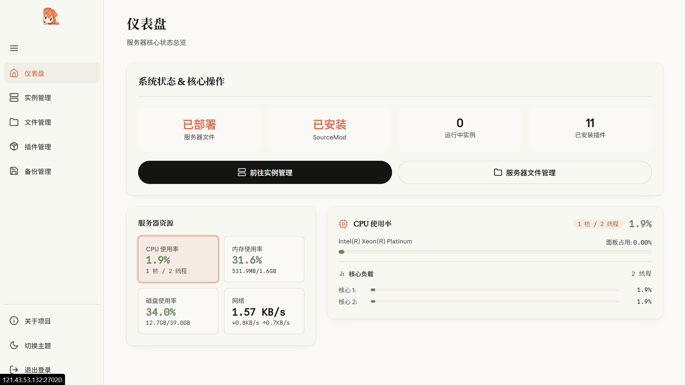
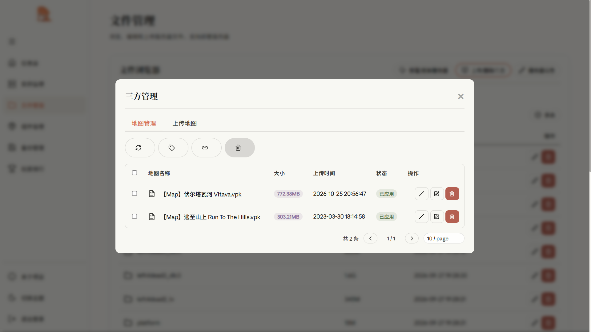
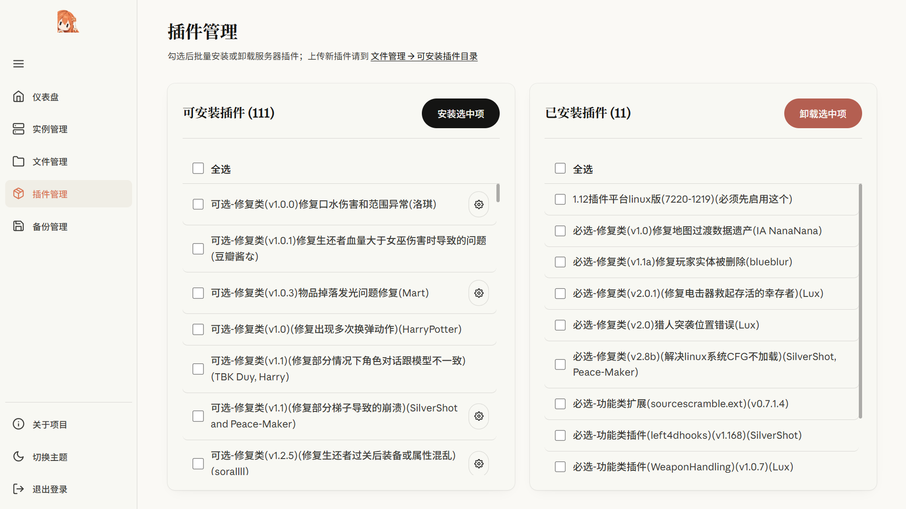
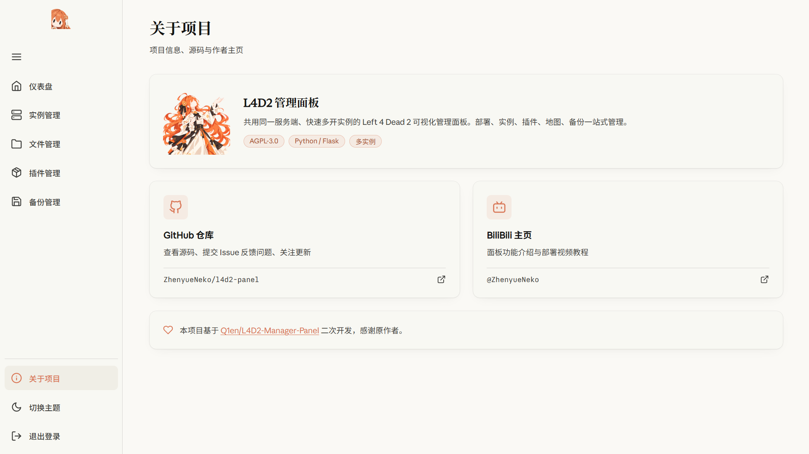

<p align="center"></p>

# L4D2 管理面板 

这是一个共用同一服务端、快速多开实例的 Left 4 Dead 2 可视化管理面板。<br>
部署、实例、插件、地图、备份一站式管理

> 源项目:  [Q1en/L4D2-Manager-Panel](https://github.com/Q1en/L4D2-Manager-Panel/)
>
> 感谢原作者项目
>
> 本项目在前端交互、功能实现、目录结构等方面与原项目相比改动较大，因此不再 fork 而是单独起项

## 适用场景

- **省磁盘**：只部署一次服务端，往后所有实例共用，多开不再成倍占用空间
- **省时间**：Web网页上可快速 新增/删除 实例，不再需要复制服务端目录、不用改脚本
- **一服多用**：一个服务端开出多台服务器，例：27015 用于开主服招募同好、27016 用于与朋友开黑

## 安装与启动

```bash
# 1. 安装 git（已装可跳过）
sudo apt install -y git

# 2. 克隆项目到 /opt/l4d2-panel
cd /opt
git clone https://github.com/ZhenyueNeko/l4d2-panel.git l4d2-panel
cd l4d2-panel/scripts/

# 3. 交互式菜单：安装系统依赖 → 配置面板信息 → 启动面板
bash /opt/l4d2-panel/scripts/manage.sh
```

## 视频教程

- [面板功能介绍](https://www.bilibili.com/video/BV1rRHP6qEN2/?spm_id_from=333.1387.list.card_archive.click) 
- [面板部署教程](https://www.bilibili.com/video/BV1PznU6YEQK/?spm_id_from=333.1387.list.card_archive.click) 

## 预览截图

<p align="center">
  
  
  
  
</p>
